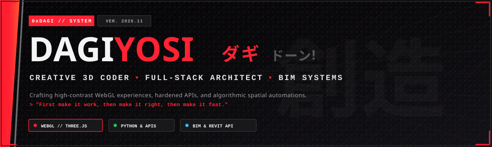

<div align="center">

  <!-- ==================== MANGA-NOIR HERO BANNER ==================== -->
  

  <br/><br/>

  <!-- ==================== THE 3D WEBGL EXPERIENCE CALL-TO-ACTION ==================== -->
  <a href="https://dagiyosi-pixel.github.io">
    
  </a>

  <br/><br/>

  <!-- ==================== ANIMATED TERMINAL TYPING SVG ==================== -->
  <a href="https://dagiyosi-pixel.github.io">
    
  </a>

  <br/>

  <!-- ==================== STATUS SHIELDS ==================== -->
  <a href="https://github.com/dagiyosi-pixel">
    
  </a>
  &nbsp;
  
  &nbsp;
  

</div>

---

### ⚔️ ACT 01 // THE ARCHETYPE (`whoami`)

```yaml
identity: Dagiyosi (0xDagi / ダギ)
discipline: Creative 3D Coding • Full-Stack Engineering • Computational BIM
creed: "First make it work, then make it right, then make it fast."
superpower: Merging graphic-novel aesthetics with rock-solid algorithmic engineering.
active_vault:
  - WebGL & Three.js Shaders (GLSL Cel-Shading & Cross-Hatching)
  - Full-Stack Architecture (FastAPI, Node.js, PostgreSQL, TypeScript)
  - Revit API & Precast Structural Automation (Hollow-Core Slabs, Corbels, Ledge Beams)
contact: dagiyosi5321@gmail.com
```

> *"I work at the intersection of design, engineering, and spatial systems. I care about semantic markup, responsive layouts that behave on every viewport, accessible components, and code that stays clean six months later. On the backend, I wire up hardened APIs, databases, and authentication so the frontend has something indestructible to talk to."*

---

### 🧰 ACT 02 // TECHNICAL ARSENAL

| Sector | Weapons of Choice |
| :--- | :--- |
| **🎨 Creative 3D & Frontend** | `Three.js` `WebGL / GLSL` `GSAP 3` `Lenis Scroll` `React` `TypeScript` `Tailwind CSS` |
| **⚙️ Backend & Systems** | `Python (FastAPI / Flask)` `Node.js (Express)` `RESTful APIs` `WebSocket Bridges` |
| **🗄️ Databases & Tooling** | `PostgreSQL` `Supabase` `SQLite` `Prisma ORM` `Git` `GitHub Actions CI/CD` |
| **🏛️ Computational BIM** | `Autodesk Revit API` `pyRevit` `Precast Hollow-Core Engines` `PCI / Eurocode Sizing` |

<br/>

<div align="center">
  
  
  
  
  
  
  
</div>

---

### 🏛️ ACT 03 // MASTER CHRONICLES (FLAGSHIP BUILDS)

#### 1. 🇪🇹 [Ethiopian National Curriculum Platform • Grade 7 & 8 SQ3R Examination Mastery](https://dagiyosi-pixel.github.io/ethiopia-curriculum-sq3r-platform/)
An authentic, offline-first study, examination simulation, and honors certification platform for Ethiopian middle school students based on the evidence-backed **SQ3R methodology** (Survey, Question, Read, Recite, Review) and aligned with the official FDRE Ministry of Education CBA curriculum.
* **Curriculum Coverage:** 96 Units & 184 Subtopics across Mathematics, General Science, English, Social Studies, Citizenship Education, and IT.
* **🏛️ Ministry Exam Hall Simulator (የፈተና አዳራሽ):** Timed mock examination engine with selectable question counts (10, 20, 40, or 60 Qs), real-time countdown clock, flag/bookmark review, letter grading ($A+$ Distinction to $F$), and diagnostic prescriptions.
* **🎓 Shareable "Ministry Honors Certificate" Generator (የምስክር ወረቀት):** Custom HTML5 Canvas ($1200 \times 840$ px) drawing the official FDRE MoE crest, Ethiopian tricolor ribbon, verified score, student rank, and 1-click HD PNG export.
* **⚡ Active Recall Flashcards & Practice Engine:** Leitner 3D flip cards, speed-match games, and 577+ Ministry-style diagnostic questions with step-by-step distractor autopsies.
* **🌐 Links:** [🚀 Launch Live App](https://dagiyosi-pixel.github.io/ethiopia-curriculum-sq3r-platform/) • [📁 Inspect Repository](https://github.com/dagiyosi-pixel/ethiopia-curriculum-sq3r-platform)

#### 2. 🏗️ [Precast BIM & Computational Structural Suite](https://github.com/dagiyosi-pixel)
Algorithmic framework for automated structural precast modeling inside Autodesk Revit API.
* **Hollow-Core Slab Layout Engine:** Algorithmic slab placement, transverse cutout handling, and web integrity preservation.
* **Inverted-T & L-Beams:** Bearing length verification, ledge shear checks, and corbel connection detailing under Eurocode & PCI standards.
* **Transaction Safe:** Automated element creation, unique piece mark tracking, and fabrication schedule exports inside strict Revit API Transactions.

#### 3. ⚡ [Manga-Noir WebGL 3D Interactive Portfolio](https://dagiyosi-pixel.github.io)
The GPU-accelerated 3D manga-noir website showcasing real-time GLSL cel-shading, dynamic ink crosshatch post-processing, Lenis momentum scrolling, interactive 3D manga hand tracking, and synthesized Web Audio sound design.
* **🌐 Links:** [🚀 Enter the 3D Experience](https://dagiyosi-pixel.github.io) • [📁 Inspect Source Code](https://github.com/dagiyosi-pixel/dagiyosi-pixel.github.io)

---

### 📊 ACT 04 // CODING RADAR & ACTIVITY

<div align="center">
  
  &nbsp;
  
</div>

<br/>

<div align="center">
  
</div>

---

### 📜 ACT 05 // SUMMON / CONTRACT

```
┌────────────────────────────────────────────────────────────────────────┐
│ EMAIL:      dagiyosi5321@gmail.com                                     │
│ GITHUB:     https://github.com/dagiyosi-pixel                          │
│ PORTFOLIO:  https://dagiyosi-pixel.github.io                          │
│ STATUS:     AVAILABLE FOR FULL-STACK & CREATIVE BUILDS                 │
└────────────────────────────────────────────────────────────────────────┘
```

<div align="center">
  <sub>Designed & engineered with manga-noir precision by <strong>0xDagi</strong>. © 2026</sub>
</div>
